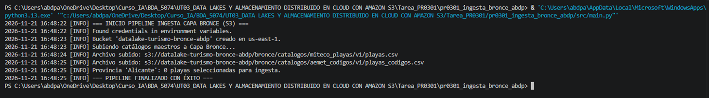
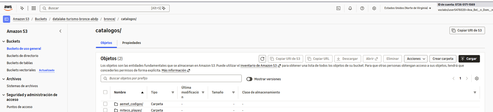
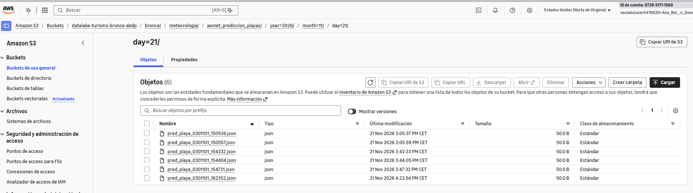

# PR00301 - Ingesta en Data Lake (Capa Bronce) sobre Amazon S3:

* **Módulo:** Big Data Aplicado
* **Unidad de Trabajo:** UT03. Data Lakes y almacenamiento distribuido en cloud con S3
* **Bucket S3:** `datalake-turismo-bronce-abdp`

---
## 1. Arquitectura de Producción (`src/`)
El pipeline modularizado consta de los siguientes componentes:
* `src/config.py`: Carga de variables de entorno desde `.env` y definición de rutas S3.
* `src/s3_manager.py`: Gestión de buckets y subida de objetos (desde disco y RAM) con metadatos mediante `boto3`.
* `src/aemet_client.py`: Cruce de catálogos por código INE y consumo de la API de AEMET (doble salto y control de cuota `429`).
* `src/main.py`: Orquestador principal con registro de eventos (`logging`).

## 2. Capturas de Ejecución y Almacenamiento en AWS S3

### Ejecución del pipeline en producción (`main.py`)



### Catálogos maestros en Capa Bronce


### Particionamiento temporal estilo Hive en S3


---
## 3. Entrega de toda la estructura de directorios comprimida en un fichero ZIP:

* `Nombre del fichero: pr0301_ingesta_bronce.zip`

---
## 4. Cuaderno de Exploración y Prototipado (Jupyter)

```python
#Paso 1: Exploración

# Objetivo: validar los formatos y las conexiones antes de pasar a scripts limpios

# 1.1. Lectura y cruce de los CSV
import pandas as pd

# 1. Cargar MITECO (UTF-8, separado por comas): 
# Abre el archivo playas.csv indicando que las columnas están separadas por comas (sep=',') y el texto usa codificación estándar (encoding='utf-8')
# Con dtype={'Código_IN': str} fuerza a que el código INE se lea como texto y no como número. Esto es crucial: si lo leyera como número, el código '03011' (Alicante) perdería el cero inicial y se convertiría en 3011, rompiendo el cruce posterior.

df_miteco = pd.read_csv('../data/playas.csv', sep=',', encoding='utf-8', dtype={'Código_IN': str})

# 2. Cargar AEMET (ISO-8859-1 / latin1, separado por punto y coma)
# Abre playas_codigos.csv especificando que usa punto y coma (sep=';') y codificación occidental antigua (encoding='latin1') para que no se corrompan las tildes ni las eñes
# fuerza a texto (str) tanto el ID_PLAYA como el ID_MUNICIPIO para conservar los ceros a la izquierda
df_aemet = pd.read_csv('../data/playas_codigos.csv', sep=';', encoding='latin1', dtype={'ID_PLAYA': str, 'ID_MUNICIPIO': str})

# Filtrar por una provincia (ej. Alicante)
codigos_ine_prov = df_miteco[df_miteco['Provincia'] == 'Alicante']['Código_IN'].unique()

# Obtener playas de AEMET que coincidan con esos municipios (máximo 15)
playas_filtradas = df_aemet[df_aemet['ID_MUNICIPIO'].isin(codigos_ine_prov)].head(15)
lista_ids_playa = playas_filtradas['ID_PLAYA'].tolist()
print(f"IDs seleccionados ({len(lista_ids_playa)}):", lista_ids_playa)

```

    IDs seleccionados (0): []
    


```python
# 1.2. Prueba de doble salto contra la API de AEMET

# AEMET devuelve los datos finales codificados en ISO-8859-15 o latin1, por lo que debes forzar la decodificación de la respuesta para no romper tildes ni eñes
import time
import requests

# 1  Preparación de la consulta:
# Define una función que recibe dos datos: el identificador numérico de la playa (id_playa) y tu clave personal de acceso (api_key)

def obtener_prediccion_playa(id_playa: str, api_key: str) -> list | None:

    # Construye la dirección web exacta de AEMET para esa playa y guarda tu clave en la cabecera (headers) para identificarte ante el servidor
    url_base = f"https://opendata.aemet.es/opendata/api/prediccion/especifica/playa/{id_playa}"
    headers = {'api_key': api_key}

     
    try:
        # SALTO 1: Pedir permiso y obtener el enlace de descarga

        # La API de AEMET no entrega los datos directamente en la primera llamada, sino que primero te da una URL temporal donde están guardados
        # Envía la primera petición a AEMET con un tiempo máximo de espera de 10 segundos (timeout=10)
        res1 = requests.get(url_base, headers=headers, timeout=10)     

        # Si haces demasiadas peticiones muy rápido, AEMET bloquea temporalmente el acceso con el código 429. 
        # Si esto ocurre, el programa muestra un aviso, espera 15 segundos (time.sleep(15)) y vuelve a intentar la petición una vez más
        if res1.status_code == 429:
            print(f"[429] Límite alcanzado en {id_playa}. Esperando 15s...")
            time.sleep(15)
            res1 = requests.get(url_base, headers=headers, timeout=10)
        # Verifica si hubo algún otro error en la respuesta (Ej: clave inválida o servidor caído). Si lo hay, detiene la ejecución y salta al bloque except del final(except requests.RequestException)   
        res1.raise_for_status()
        # Lee la respuesta en formato JSON y 
        # extrae la URL real donde se encuentra el pronóstico bajo la clave 'datos'
        payload_control = res1.json()
        url_datos = payload_control.get('datos')
        # Si AEMET responde correctamente pero no incluye enlace de descarga (por Ej:si el ID de la playa no existe), imprime el motivo y devuelve None (vacío)
        if not url_datos:
            print(f"Sin URL de datos para {id_playa}: {payload_control.get('descripcion')}")
            return None
            
        # SALTO 2: Descargar los datos reales del tiempo

        #Entra en la URL temporal obtenida en el paso anterior para descargar finalmente la predicción del tiempo
        res2 = requests.get(url_datos, timeout=10)
        res2.raise_for_status()
        # Aquí se aplica exactamente lo que consultabas antes. Como los servidores de AEMET entregan estos archivos con codificación occidental antigua, esta línea fuerza a Python a leerlos en latin1 para que nombres de playas con tildes o "ñ" (como A Coruña o Peñíscola) no se rompan
        res2.encoding = 'latin1'
        # Convierte los datos descargados en una estructura de listas/diccionarios de Python lista para analizar y la devuelve como resultado final de la función.
        return res2.json()
    # Es una red de segurida: Si se cae internet, tarda más de 10 segundos o falla la conexión en cualquiera de los dos saltos, evita que todo tu programa se cierre de golpe; en su lugar, muestra el error en pantalla y devuelve None.
    except requests.RequestException as e:
        print(f"Error de red con playa {id_playa}: {e}")
        return None

```


```python
# 1.3. Prueba de conexión y subida a S3

# verifica la conexión con Amazon S3,
# crea un contenedor de almacenamiento (bucket)
# sube datos tanto desde archivos físicos en tu ordenador como directamente desde la memoria RAM, organizándolos como un Data Lake (capa Bronce).

# Comprueba que puedes crear el bucket y subir archivos tanto desde disco como desde RAM.

import os
import json
from pathlib import Path
from datetime import datetime
import boto3
from botocore.exceptions import ClientError
from dotenv import load_dotenv, find_dotenv

# 0. Cargar variables de entorno (.env) forzando actualización

# Busca tu archivo oculto .env y
# carga tus claves de AWS (AWS_ACCESS_KEY_ID, AWS_SECRET_ACCESS_KEY, etc.) en el entorno. El parámetro override=True obliga a actualizar las variables si ya existían en memoria
load_dotenv(find_dotenv(), override=True)
# Lee el nombre del bucket 
# y la región desde el .env. Si no los encuentra, usa los valores por defecto (datalake-turismo-bronce-abdp y us-east-1).
bucket = os.getenv('S3_BUCKET_NAME', 'datalake-turismo-bronce-abdp')
region = os.getenv('AWS_DEFAULT_REGION', 'us-east-1')

# Inicializar cliente S3
# Crea el cliente oficial de AWS (boto3) para poder comunicarte con el servicio S3 desde Python
s3 = boto3.client('s3', region_name=region)

# Detectar carpeta data automáticamente
# Comprueba si la carpeta data está en tu directorio actual (./data) o un nivel por encima (../data) para evitar errores de ruta sin importar desde dónde ejecutes el notebook
ruta_data = Path('./data') if Path('./data').exists() else Path('../data')

# 1. Crear bucket en S3
# s3.create_bucket(...): Intenta crear el contenedor en la nube.
# Tiene un if especial porque AWS exige omitir el bloque CreateBucketConfiguration cuando la región es us-east-1, mientras que en cualquier otra región (como Europa) es obligatorio indicarlo
try:
    if region == 'us-east-1':
        s3.create_bucket(Bucket=bucket)
    else:
        s3.create_bucket(
            Bucket=bucket,
            CreateBucketConfiguration={'LocationConstraint': region}
        )
    print(f"Bucket '{bucket}' creado en {region}.")
# except ClientError: Si el bucket ya existe (porque ejecutaste este código antes), captura el error sin detener el programa y muestra un aviso informativo. Si es otro error (como claves incorrectas o falta de permisos), sí detiene la ejecución (raise e)
except ClientError as e:
    error_code = e.response['Error']['Code']
    if error_code in ('BucketAlreadyOwnedByYou', 'BucketAlreadyExists'):
        print(f"Aviso: El bucket '{bucket}' ya existe.")
    else:
        raise e

# 2. Subida desde disco (Catálogos en crudo): Este bloque toma archivos que ya tienes guardados en tu disco duro y los sube a la nube
# s3.upload_file(...): Sube playas.csv (de MITECO) y playas_codigos.csv (de AEMET) desde tu carpeta local data hacia S3
# Key: Define la ruta virtual donde se guardarán dentro del bucket siguiendo una estructura ordenada de Data Lake (bronce/catalogos/...)
# ExtraArgs={'Metadata': ...}: Añade etiquetas invisibles (metadatos) al archivo en S3 para documentar de dónde vienen los datos y qué versión son
s3.upload_file(
    Filename=str(ruta_data / 'playas.csv'),
    Bucket=bucket,
    Key='bronce/catalogos/miteco_playas/v1/playas.csv',
    ExtraArgs={'Metadata': {'origen': 'miteco', 'version': 'v1'}}
)

s3.upload_file(
    Filename=str(ruta_data / 'playas_codigos.csv'),
    Bucket=bucket,
    Key='bronce/catalogos/aemet_codigos/v1/playas_codigos.csv',
    ExtraArgs={'Metadata': {'origen': 'aemet', 'version': 'v1'}}
)
print("Catálogos subidos a S3.")

############ Respaldo por si no se ejecutó la celda 1.2 previamente
if 'id_prueba' not in locals() or 'datos_playa' not in locals():
    id_prueba = "0301101"
    datos_playa = [{"nombre": "Prueba de conexion", "estado": "OK"}]
    print("Aviso: Usando datos simulados porque no se ejecutó la celda 1.2")

# 3. Subida desde RAM (JSON de predicción con particionamiento Hive)
ahora = datetime.now()
s3_key_prediccion = (
    f"bronce/meteorologia/aemet_prediccion_playas/"
    f"year={ahora:%Y}/month={ahora:%m}/day={ahora:%d}/"
    f"pred_playa_{id_prueba}_{ahora:%H%M%S}.json"
)

s3.put_object(
    Bucket=bucket,
    Key=s3_key_prediccion,
    Body=json.dumps(datos_playa, ensure_ascii=False).encode('utf-8'),
    ContentType='application/json',
    Metadata={'id_playa': str(id_prueba), 'fuente': 'aemet'}
)
print(f"Predicción subida a: s3://{bucket}/{s3_key_prediccion}")

```

    Bucket 'datalake-turismo-bronce-abdp' creado en us-east-1.
    Catálogos subidos a S3.
    Aviso: Usando datos simulados porque no se ejecutó la celda 1.2
    Predicción subida a: s3://datalake-turismo-bronce-abdp/bronce/meteorologia/aemet_prediccion_playas/year=2026/month=11/day=21/pred_playa_0301101_162352.json
    


---
[Volver al índice](../index.md)